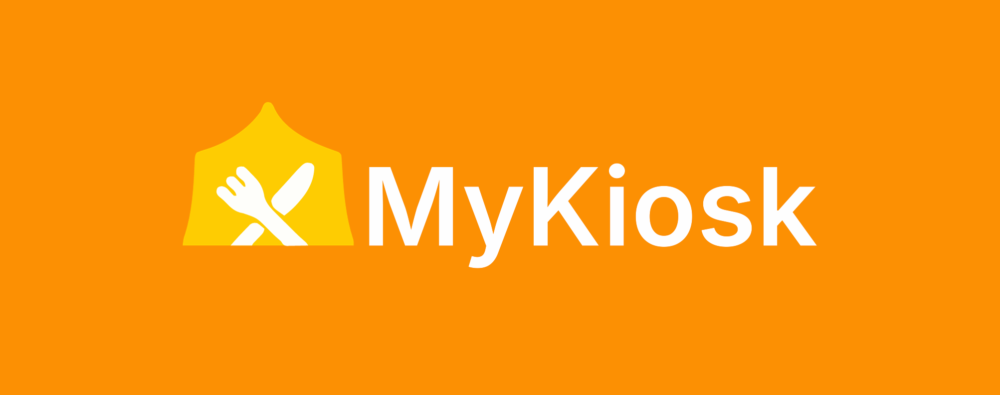

<div align="center">

<p align="center">
  
</p>

# 🏪 MyKiosk

**Kiosk Start Page for the MySagra Apps**

[](https://polyformproject.org/licenses/shield/1.0.0)
[](https://nextjs.org/)
[](https://reactjs.org/)
[](https://www.typescriptlang.org/)

[Features](#-features) • [Installation](#-installation) • [Docker](#-docker-deployment) • [Kiosk Setup](#️-kiosk-setup) • [Tech Stack](#️-tech-stack) • [Contributing](#-contributing)

</div>

---

## 📖 About

**MyKiosk** is the start page for laptops running in kiosk mode at food events and sagre. It shows large, touch-friendly buttons to the MySagra applications and tells staff at a glance which ones are reachable.

Part of the **MySagra** ecosystem, MyKiosk links to [MyAmministratore](https://github.com/MySagra/mysagra), [MyCassa](https://github.com/MySagra/mycassa), [MyNumeri](https://github.com/MySagra/mynumeri) (with a direct link to its public display, MyDisplay), [MyComanda](https://github.com/MySagra/mycomanda) and [MyClienti](https://github.com/MySagra/myclienti). It is designed for on-site installations on a local network without internet access, and the same Docker image also runs in the cloud.

## ✨ Features

### 🎯 Core Functionality
- **App Launcher** - Large cards for MyAmministratore, MyCassa, MyNumeri, MyComanda and MyClienti, each with its own logo, description and accent color
- **Configurable Buttons** - A card is shown only when the URL of its app is set; with no app configured, the page lists the variables to set
- **Status Indicators** - Each card shows whether its app is online or not responding; offline apps are dimmed but stay clickable
- **Clock** - Current time with a blinking separator and today's date

### 📡 Status Monitoring
- **Server-side Checks** - The `/api/health` route checks every configured URL from the server, so there are no CORS issues
- **Configurable Interval** - Every 15 seconds by default, with a 4-second timeout per app; can be disabled
- **Clear Error Reasons** - The health response reports why an app is down (connection refused, timeout, certificate error)

### 🖥️ Kiosk Mode
- **Touch-friendly Layout** - Responsive grid that adapts from a phone to a laptop screen
- **Locked-down Page** - Context menu, text selection and dragging are disabled
- **Offline Ready** - Fonts and assets are bundled in the image; the page makes no requests to external hosts

### 🎨 User Experience
- **Modern UI** - Built with shadcn/ui components and the shared MySagra theme
- **Dark/Light Mode** - Theme switching with next-themes, dark by default
- **Multi-language** - Italian and English via i18next, switchable from the bottom-right corner
- **Persistent Preferences** - Language and theme are saved in the kiosk browser

### 🛠️ Technical Features
- **Runtime Configuration** - One image for every installation, configured only through environment variables, with no rebuild
- **Validated Settings** - Environment variables are checked with Zod at startup; an invalid value stops the container with a clear message
- **Type Safety** - Full TypeScript implementation, including the app registry and translations
- **Docker Support** - Multi-stage build with Next.js standalone output, running as a non-root user

## 🚀 Installation

### Prerequisites

- **Node.js** 24.x (the version used by the Docker image)
- **npm**
- The URLs of the MySagra apps to show

### Local Development

1. **Clone the repository**
   ```bash
   git clone https://github.com/MySagra/mykiosk.git
   cd mykiosk
   ```

2. **Install dependencies**
   ```bash
   npm install
   ```

3. **Configure environment variables**

   Create a `.env` file based on `.env.example`:
   ```bash
   cp .env.example .env
   ```

   Set the address of the MySagra server, as in the general MySagra docker compose. The app URLs are built from it with the standard ports:
   ```env
   SERVER_IP=192.168.50.100
   MYAMMINISTRATORE_URL=http://${SERVER_IP}:3030
   MYCASSA_URL=http://${SERVER_IP}:3031
   MYNUMERI_URL=http://${SERVER_IP}:3033
   MYCOMANDA_URL=http://${SERVER_IP}:3035
   MYCLIENTI_URL=http://${SERVER_IP}:3034
   ```

   > **Note**: An empty URL hides the corresponding card. Environment variables are read by the server at runtime, never inlined in the client bundle.

4. **Run the development server**
   ```bash
   npm run dev
   ```

5. **Open your browser**

   Navigate to [http://localhost:3036](http://localhost:3036)

## 🐳 Docker Deployment

MyKiosk includes full Docker support for production deployments.

### Using the Published Image

Every GitHub release is published to the GitHub Container Registry for `linux/amd64` and `linux/arm64`:

```bash
docker pull ghcr.io/mysagra/mysagra-mykiosk:latest
```

To use it with Docker Compose, set `image: ghcr.io/mysagra/mysagra-mykiosk:latest` in `docker-compose.yml` and remove the `build:` section.

### Using Docker Compose (on-site)

In a full installation MyKiosk runs from the general MySagra docker compose, which already includes it. To run it on its own, on the MySagra server:

1. **Create the `.env` file** and set `SERVER_IP` to the server address
   ```bash
   cp .env.example .env
   ```

2. **Add the local CA certificate** if the apps use HTTPS (the same `rootCA.pem` mounted by MyCassa and MyNumeri)
   ```bash
   cp /path/to/rootCA.pem .
   ```

3. **Build and run the container**
   ```bash
   docker compose up -d --build
   ```

4. **Access the application**

   The kiosk will be available on port 3036 of the server, for example `http://192.168.50.100:3036`

To change the buttons, edit `.env` and run `docker compose up -d`: no rebuild is needed.

> **Note**: With `SERVER_IP=localhost` the links work in a browser on the same machine, but inside the container `localhost` is the container itself. The status check therefore reaches `localhost` URLs through `host.docker.internal`, which the compose file maps to the host with `extra_hosts`.

> **Note**: Without `rootCA.pem`, apps served over HTTPS with the local CA are reported as not responding. The compose file mounts it and sets `NODE_EXTRA_CA_CERTS`.

### Running in the Cloud

The same image works in the cloud, with different variables only (see the cloud example in `.env.example`):

```bash
docker run -d --name mykiosk -p 3036:3036 \
  -e MYCASSA_URL=https://cassa.yoursagra.example \
  -e MYNUMERI_URL=https://numeri.yoursagra.example \
  ghcr.io/mysagra/mysagra-mykiosk:latest
```

Put it behind the reverse proxy like the other MySagra apps.

### Docker Configuration

The application uses a multi-stage Dockerfile for optimized builds:
- **Dependencies stage** - Installs npm packages
- **Builder stage** - Builds the Next.js application and downloads the fonts
- **Runner stage** - Minimal production image running as a non-root user on port 3036

The release version is injected at build time and printed in the container startup log.

## 🖥️ Kiosk Setup

On the kiosk laptop (Debian + cage), open the browser in kiosk mode on the MyKiosk URL, for example in the service or script that starts cage. With the general MySagra docker compose MyKiosk is published on port 80, so the URL is just the server address:

```bash
cage -- chromium --kiosk --noerrdialogs --disable-translate --no-first-run http://192.168.50.100
```

or with Firefox:

```bash
cage -- firefox --kiosk http://192.168.50.100
```

> **Note**: When MyKiosk runs on its own with this repository's `docker-compose.yml`, add the port: `http://192.168.50.100:3036`.

> **Note**: Apps open in the same window and the kiosk has no address bar or back button. To return to the start page, use a link in the app, the `Alt+←` shortcut, or restart the browser.

## 🛠️ Tech Stack

### Frontend Framework
- **[Next.js 16](https://nextjs.org/)** - React framework with App Router
- **[React 19](https://reactjs.org/)** - UI library
- **[TypeScript 5](https://www.typescriptlang.org/)** - Type safety

### UI Components & Styling
- **[shadcn/ui](https://ui.shadcn.com/)** - Re-usable component library
- **[Radix UI](https://www.radix-ui.com/)** - Unstyled, accessible components
- **[Tailwind CSS 4](https://tailwindcss.com/)** - Utility-first CSS framework
- **[Lucide React](https://lucide.dev/)** - Icon library
- **[next-themes](https://github.com/pacocoursey/next-themes)** - Dark and light mode

### Internationalization
- **[i18next](https://www.i18next.com/)** - Translation framework
- **[react-i18next](https://react.i18next.com/)** - React bindings for i18next

### Validation & Utilities
- **[Zod](https://zod.dev/)** - Environment variable validation
- **[clsx](https://github.com/lukeed/clsx)** - Conditional className utility
- **[tailwind-merge](https://github.com/dcastil/tailwind-merge)** - Merge Tailwind classes

## 📁 Project Structure

```
mykiosk/
├── app/                    # Next.js App Router
│   ├── api/health/        # Server-side status checks
│   ├── layout.tsx         # Fonts, theme and language providers
│   └── page.tsx           # Kiosk start page
├── components/            # React components
│   ├── kiosk/            # App grid, clock, language and theme switchers
│   └── ui/               # shadcn/ui components
├── lib/                   # Configuration and utilities
│   ├── apps.ts           # Registry of the apps shown in the kiosk
│   ├── config.ts         # Environment variable validation
│   └── i18n/             # Translations (Italian and English)
├── public/                # Static assets
│   └── logos/            # App logos
├── .github/workflows/     # CI and Docker publish workflows
├── Dockerfile             # Docker configuration
└── docker-compose.yml     # Docker Compose configuration (on-site)
```

## 📜 Available Scripts

| Command | Description |
|---------|-------------|
| `npm run dev` | Start development server on port 3036 |
| `npm run build` | Build production bundle |
| `npm start` | Start production server on port 3036 |
| `npm run lint` | Run ESLint for code quality |

## 🔧 Environment Variables

| Variable | Description | Example |
|----------|-------------|---------|
| `SERVER_IP` | Address of the MySagra server, used to build the default app URLs | `192.168.50.100` |
| `MYAMMINISTRATORE_URL` | MyAmministratore URL; empty hides the card | `http://${SERVER_IP}:3030` |
| `MYCASSA_URL` | MyCassa URL; empty hides the card | `http://${SERVER_IP}:3031` |
| `MYNUMERI_URL` | MyNumeri URL; empty hides the card, and the MyDisplay card with it (MyDisplay opens `MYNUMERI_URL` + `/display`) | `http://${SERVER_IP}:3033` |
| `MYCOMANDA_URL` | MyComanda URL; empty hides the card | `http://${SERVER_IP}:3035` |
| `MYCLIENTI_URL` | MyClienti URL; empty hides the card | `http://${SERVER_IP}:3034` |
| `KIOSK_CHECK_INTERVAL` | Seconds between status checks; `0` disables them (default `15`) | `15` |

> **Architecture Note**: URLs must be complete (`http://` or `https://`). All variables are validated when the container starts; an invalid value stops the container and the log names the variable to fix.

### Adding an App

1. Add an entry to [`lib/apps.ts`](lib/apps.ts) (id, name, environment variable, logo and accent color)
2. Put its square SVG logo in [`public/logos`](public/logos)
3. Add its description to [`lib/i18n/locales`](lib/i18n/locales) (`it.ts` and `en.ts`; TypeScript flags a missing one)
4. Rebuild the image: the card appears once the new variable is set

For a direct link to a page of another app (like MyDisplay), use `from: { app, path }` instead of an environment variable: the card follows that app and opens its URL plus `path`.

## 🔄 Continuous Integration

- **CI** ([`.github/workflows/ci.yml`](.github/workflows/ci.yml)) - Runs lint, type check and build on every push and pull request to `main`
- **Publish** ([`.github/workflows/publish.yml`](.github/workflows/publish.yml)) - Builds and pushes the Docker image to `ghcr.io/mysagra/mysagra-mykiosk` on every published release, tagged with the release version and `latest`

## 🤝 Contributing

Contributions are welcome! Please follow these guidelines:

1. **Fork the repository**

2. **Create a feature branch**
   ```bash
   git checkout -b feature/amazing-feature
   ```

3. **Commit your changes**
   ```bash
   git commit -m 'Add some amazing feature'
   ```

4. **Push to the branch**
   ```bash
   git push origin feature/amazing-feature
   ```

5. **Open a Pull Request**

### Development Guidelines

- Follow the existing code style and conventions
- Write meaningful commit messages
- Update documentation for significant changes
- Test your changes thoroughly before submitting
- Ensure TypeScript types are properly defined

## 📄 License

This project is licensed under the **PolyForm Shield License 1.0.0**.

This means:
- ✅ You can use, modify, and distribute this software
- ✅ You can use it for your own restaurant, cafe, or event
- ❌ You cannot use it to build a product that competes with MySagra

See the [LICENSE](LICENSE.md) file for full details.

## 🙏 Acknowledgments

- Built with [Next.js](https://nextjs.org/) by Vercel
- UI components from [shadcn/ui](https://ui.shadcn.com/)
- Icons from [Lucide](https://lucide.dev/)
- Part of the [MySagra](https://github.com/MySagra) ecosystem

## 📞 Support

If you encounter any issues or have questions:

- 🐛 [Open an issue](https://github.com/MySagra/mykiosk/issues)
- 💬 Check existing issues for solutions
- 📧 Contact the MySagra team

---

<div align="center">

**Made with ❤️ by the MySagra Team**

[⬆ Back to Top](#-mykiosk)

</div>
